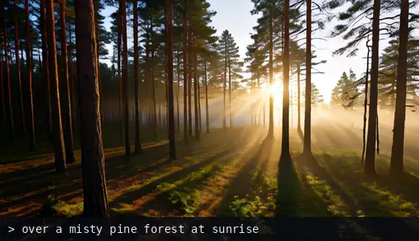
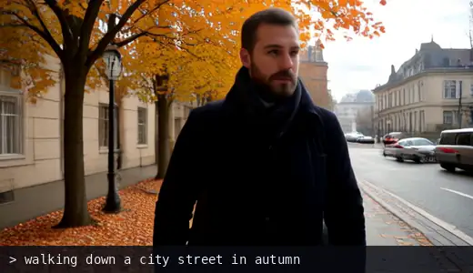
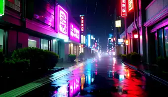
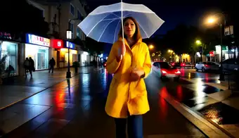
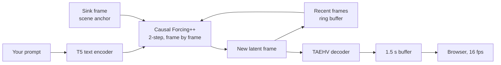

<div align="center">

# InfiniteStream

### Type a sentence. The video changes. It keeps going.

Endless, text-steerable AI video, generated live at 832×480 on a single RTX 4090.

[](LICENSE)


</div>

<p align="center">
  
  
</p>
<p align="center">
  
  
  
  
  
  
</p>
<p align="center"><sub>Real output at the default settings, downscaled and compressed for this page, with no interpolation or retouching. Each clip is the pick of 2–3 seeds and runs 7–25 s; captions abbreviate the prompts. Clips with people use a community fine-tune and LoRA loaded with <code>--lora</code>.</sub></p>

## Why it's different

- **Faster than playback on a consumer GPU.** 17.7 fps generated against 16 fps played, held for 10 straight minutes on one RTX 4090.
- **No clip length.** Most local video models render a fixed clip and stop. A rolling attention window keeps this one going for as long as you leave it running.
- **Steer it while it plays.** Prompts apply between frames, so the picture morphs into the new scene with no cut and no restart.
- **Yours, in a browser tab.** Everything runs on your machine: no cloud, no queue, no account.
- **Bring your own style.** Any Wan 2.1 T2V 1.3B LoRA or fine-tune merges in at boot, with no per-frame cost.

## Quick start

You need Linux, an NVIDIA GPU with 24 GB of VRAM (tested on an RTX 4090), Python 3.10 and about 25 GB of disk space.

```bash
git clone https://github.com/SolvAI/InfiniteStream.git
cd InfiniteStream
conda create -n infinitestream python=3.10 -y && conda activate infinitestream
./setup.sh         # upstream code, dependencies and about 23 GB of weights
python live.py     # about 1.5 min to load and compile, then open http://localhost:8000
```

Type a prompt and press Enter. Long, descriptive prompts work best.

- **Related changes** (season, weather, time of day, lighting) start 1–2 s after you press Enter and settle within a few seconds.
- **Unrelated scenes** (a forest to a city) blend more slowly and can take 10 s or more.
- **Reset canvas** starts over from your prompt with a hard cut, then steering carries on as usual. Use it for big jumps, or when an artifact won't go away.

## How it works



The generator is [Causal Forcing++](https://github.com/thu-ml/Causal-Forcing), a frame-by-frame distillation of Wan 2.1 that is natively limited to 81 frames. These changes turn it into a stream:

| Technique | What it does |
|---|---|
| **Ring-buffer KV cache** | New frames overwrite the oldest slot instead of shifting the whole cache. Cost per frame stays flat, and `torch.compile` stops recompiling. |
| **Sliding sink** (from [Deep Forcing](https://arxiv.org/abs/2512.05081)) | One anchor frame stays in attention, moved in time to sit right before the recent frames. Without it the picture collapses within seconds. |
| **KV flush** (from [Infinity-RoPE](https://arxiv.org/abs/2511.20649)) | On a prompt change, only the last 2 frames are kept, so the old scene can't outvote the new prompt. |
| **Sink regeneration** | The anchor is regenerated from the new prompt, which is what makes the scene actually change. It also refreshes every 8 s to limit drift. |
| **Speed stack** | FP8 weights (torchao), `torch.compile` on the dense layers, and the [TAEHV](https://github.com/madebyollin/taehv) tiny decoder in place of the Wan VAE. |

## Performance

Measured on one RTX 4090. Real time needs 16 fps, which is 250 ms per 4-frame block.

| | |
|---|---|
| Output | 832×480 at 16 fps |
| Generation speed | 17.7 fps over 10 minutes with a new prompt every 60 s, steady from minute to minute (0.90× real-time factor). A 0.5 s start buffer is enough for zero stalls. |
| Latency | 1–2 s from Enter to the picture starting to change |
| VRAM | 15.2 GB allocated, 20–23 GB reserved (the text encoder stays on the GPU so prompt changes are instant) |
| Stability | 20 minutes with 19 prompt changes: no crash, no memory growth |

Headroom is about 10%, so the stream needs the GPU to itself. Sharing it with another GPU job dropped a 20-minute run to a 14.7 fps average.

## Options

`python live.py --help` lists everything. The ones that matter most:

| Flag | Default | Effect |
|---|---|---|
| `--prompt` | a forest flyover | Opening prompt |
| `--window` | `6` | Frames kept in attention. Larger is slower. |
| `--sink` | `1` | Anchor frames. More anchors hold the scene harder and ignore prompts more. |
| `--keep` | `2` | Frames kept across a prompt change. `1` clears old artifacts faster but is less smooth. |
| `--refresh_s` | `8` | Seconds between anchor refreshes. `0` turns it off. |
| `--max_buffer` | `1.5` | Seconds of buffered video. Lower means less prompt latency and less tolerance for slow frames. |
| `--lora` | none | `PATH[:SCALE]` of a LoRA or fine-tune. Repeatable. |
| `--host`, `--port` | `127.0.0.1`, `8000` | There is no authentication, so only expose it on networks you trust. |

### Control it from anything

```bash
curl -X POST localhost:8000/prompt -d 'A storm rolls in over the sea'
curl -X POST localhost:8000/prompt -d '{"prompt": "A quiet desert at dawn", "reset": true}'
curl localhost:8000/status      # fps, buffer, stalls, VRAM
```

The video itself is plain MJPEG at `http://localhost:8000/stream`.

### LoRAs and fine-tunes

```bash
python live.py --lora path/to/style.safetensors:0.8
```

Any Wan 2.1 T2V 1.3B LoRA or full fine-tune works. Each one is merged into the weights at load time, so speed and VRAM don't change. They are trained on the base model rather than the distilled one, so results vary; lower the scale if the output gets noisy.

### Render to a file

```bash
python stream.py --duration 60 --schedule schedules/steer60.tsv
```

This writes the video, per-frame timing and image statistics to `stream_out/<name>/`. A schedule is a text file of `<seconds>\t<prompt>` lines.

## Known limits

- **Long runs keep moving, but they don't stay pristine.** The clips above are short excerpts. In a 5-minute run with a new scene every 60 s, every scene stayed recognizable, but stray objects appeared and lingered for tens of seconds.
- **Avoid "first-person" prompts for long runs.** They tend to grow hands, handlebars or a drone in the foreground, and in a 20-minute test those rode along through every later prompt. Reset canvas clears them.
- **The look is punchy.** Expect high contrast, oversaturation and occasional blotches.
- **Only tested on an RTX 4090 under Linux.** The setup script installs a Linux x86-64 build of FlashAttention.
- **There is a hard stop at about 4.5 hours,** where the temporal position table runs out.

## Contributing

Issues and pull requests are welcome. The most useful things right now:

- **Benchmarks on other GPUs.** Open an issue with your card and the fps from the status line.
- **Better long-run quality,** especially a way to stop foreground artifacts from surviving prompt changes.
- **A lower-VRAM profile.**

## Credits

InfiniteStream stands on this work:

- [Causal Forcing](https://github.com/thu-ml/Causal-Forcing) ([paper](https://arxiv.org/abs/2602.02214)), the real-time generator
- [Wan 2.1](https://github.com/Wan-Video/Wan2.1), the base video model
- [TAEHV](https://github.com/madebyollin/taehv), the tiny video decoder
- [Deep Forcing](https://arxiv.org/abs/2512.05081), the sliding sink
- [Infinity-RoPE](https://arxiv.org/abs/2511.20649), the KV flush

## License

[Apache 2.0](LICENSE). See [NOTICE](NOTICE) for upstream attributions. Model weights are downloaded from their authors and remain under their own licenses.
